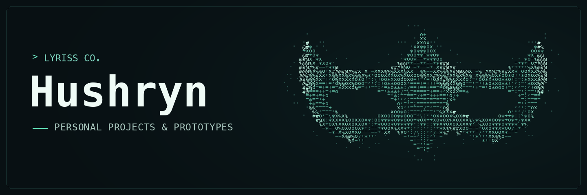

I’m Hushryn. I build small software prototypes and make ASCII artwork under **Lyriss Co.**

## Selected work

### Kosha

An interactive family budgeting demo. Try logging expenses, setting category budgets, and saving toward a goal with a fictional household.

[**Try Kosha online**](https://hushryn.github.io/kosha-demo/) · [Run offline](https://github.com/hushryn/kosha-demo#run-offline) · [Report an issue](https://github.com/hushryn/kosha-demo/issues)

### Harlequin mask in ASCII

The mask in my banner is made from plain ASCII characters. Denser symbols catch the light, and empty spaces shape the eyes.

[**View the original text**](https://gist.github.com/hushryn/d156bf247f0b009173cd1b29bfbed2d9)
